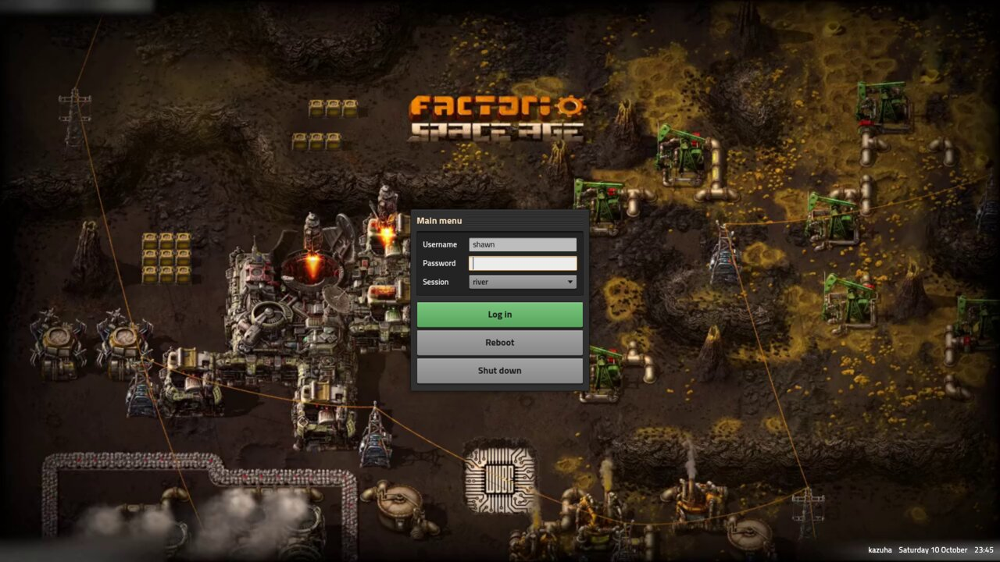

# sddm-foundry-theme

SDDM theme of factory game



## Use with Nix

```nix
{
  inputs.sddm-foundry-theme.url = "github:PandeCode/sddm-foundry-theme";
}
```

```nix
let
  theme = inputs.sddm-foundry-theme.packages.${pkgs.stdenv.hostPlatform.system}.default.override {
    background = ./login.mp4;         # image or video, default is a factorio's main screen animation
    themeConfig.Title = "kazuha";
  };
in
{
  services.displayManager.sddm = {
    enable = true;
    package = pkgs.kdePackages.sddm;
    theme = "foundry";
    extraPackages = [ theme ];
  };
  environment.systemPackages = [ theme ];
}
```

`placeholder` sets the image shown until a video starts; by default it is
the video's first frame.

## Use without Nix

Copy the repo to `/usr/share/sddm/themes/foundry`, put a background in
`Backgrounds/` and point `Background` at it in `theme.conf`, then set
`Current=foundry` under `[Theme]` in `/etc/sddm.conf`.

## Preview without logging out

```bash
nix build
sddm-greeter-qt6 --test-mode --theme result/share/sddm/themes/foundry
```

## Fonts

Titillium Web, under the SIL Open Font License, see `fonts/OFL.txt`.
